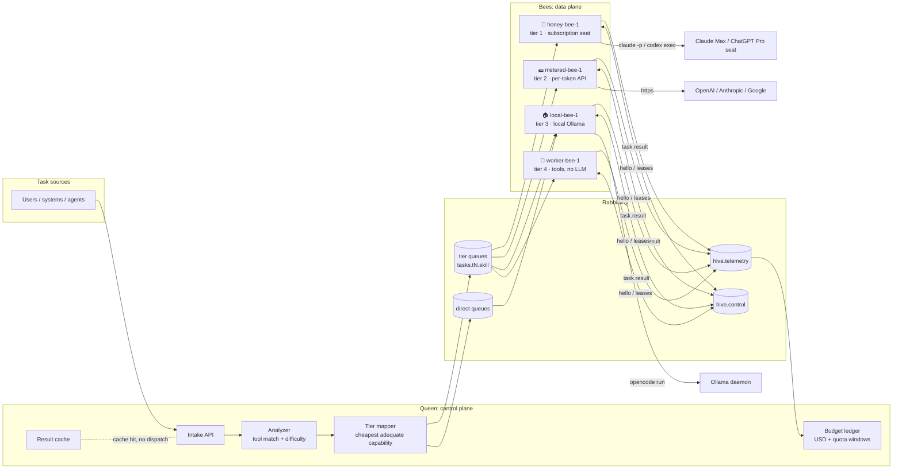
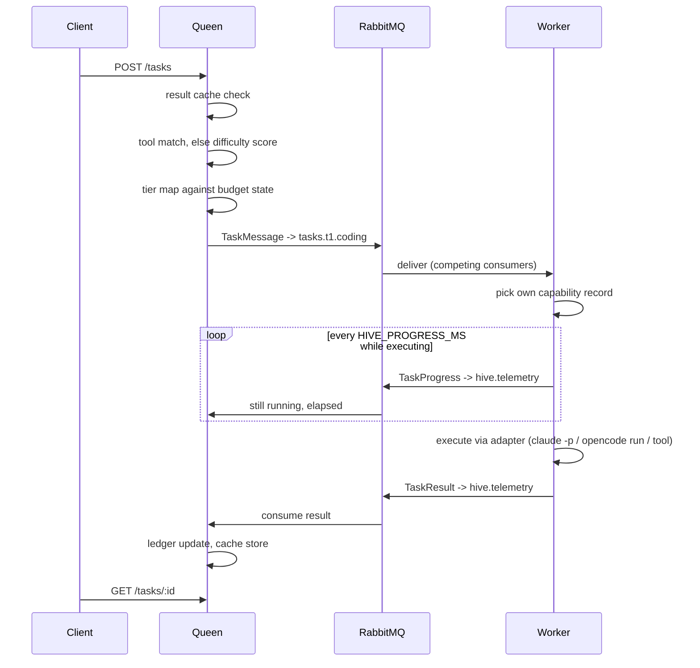
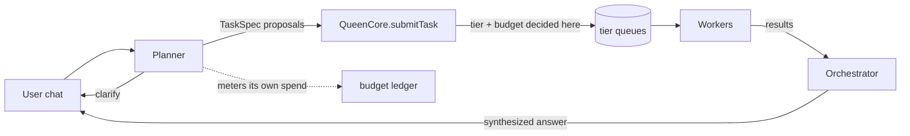
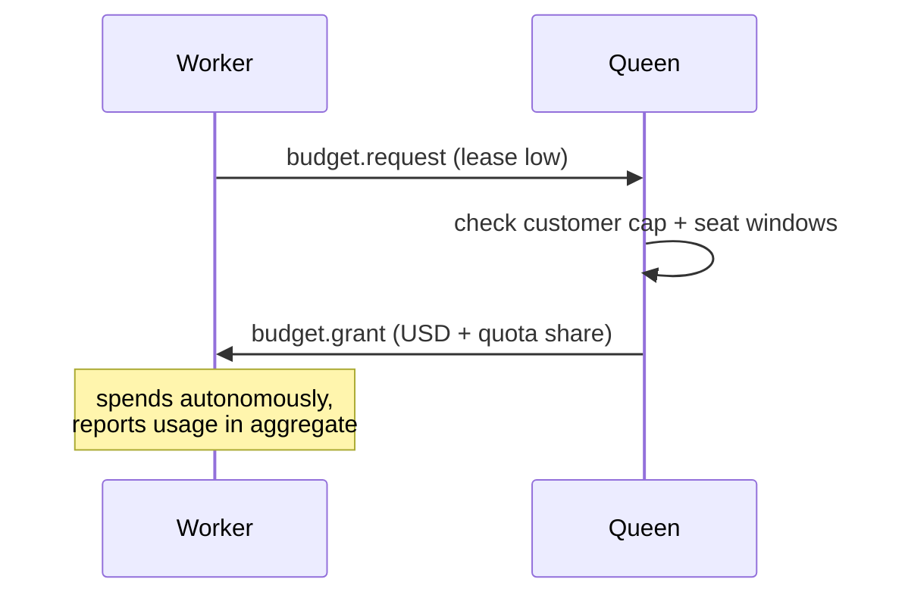

# Agent Hive

An AIoT agent management system whose single north-star metric is **token optimization**: the lowest possible cost per completed task. Worker bees do the work. The Queen keeps them coordinated, solvent, and cheap. Users talk to the Queen in plain language; she turns the conversation into tasks and routes each one to the cheapest capability that can complete it.

Every mechanism in this document — the capability ladder, tool-match-first dispatch, the dual-currency budget, leases, the result cache, even the planner's own cost ladder — is in service of that one metric. Cost is not an afterthought bolted onto a router; it *is* the router. The cheapest token is the one never spent.

AIoT Lab is the first customer. The core is customer-agnostic: everything AIoT-Lab-specific lives in `customers/aiotlab.yaml`.

## 1. Goals and non-goals

Goals:

- **Token optimization is the primary goal.** Minimize cost per completed task, per customer; every other goal is subordinate to it.
- Route every task to the most cost-effective execution capability, local or cloud.
- Keep the request path decentralized. The Queen works at task granularity. No central server sees every LLM call.
- Central budget control without central execution: the Queen sets budgets, workers spend autonomously.
- Support many customers from one core, with per-customer budgets, tools, and policies.

Non-goals (for the PoC):

- High availability, auth, multi-site federation. See the roadmap in section 9.
- Fine-grained per-message accounting. Telemetry is aggregated by design.

Why not a centralized router? A single proxy in front of every model call becomes a bottleneck, a single point of failure, and a privacy chokepoint. In Agent Hive the broker carries only small control and task messages. Model calls happen at the edge, inside each worker.

## 2. The capability model

An agent's ability is the pair **agent type x LLM model**, plus skill tags. Not the agent type alone. OpenCode on qwen3.5:4b and OpenCode on a cloud frontier model are different capabilities with different costs.

Capabilities are organized in a 4-tier ladder:

| Tier | Bee | Composition | Examples | Billing |
|---|---|---|---|---|
| 1 | 🍯 honey bee | Official agent + paid frontier model | Claude Code on a Claude Max seat, OpenAI Codex on ChatGPT Pro | subscription |
| 2 | 💵 metered bee | Paid model, per call | OpenAI / Anthropic / Google APIs, OpenCode/OpenClaw/Hermes on Ollama cloud | per-token or subscription |
| 3 | 🏠 local bee | Open-source agent + local model | OpenCode/OpenClaw/Hermes + local Ollama | local (~0) |
| 4 | 🐝 worker bee | Hardcoded tool, no LLM | parsers, report generators, converters | free |

The bee names are the tier ladder, not a second taxonomy on top of it: a bee *is* a worker process that owns one tier. That correspondence is what lets the solo launcher run all four on the embedded broker at once (§3, transport backends).

**Cost and capability are separate axes.** The key commercial insight: subscription seats are prepaid. Their marginal token cost is ~0 inside the quota window. That makes tier 1 cheaper per task than tier-2 per-token API, despite being more capable. Per-token API is the true last resort.

Cost ranking (cheapest first): free tools, local models, Ollama cloud seat, frontier seat, per-token API. For complex tasks the frontier seat outranks the mid seat: both are prepaid, so capability wins at equal cost class.

## 3. Components



Each bee owns one tier, so their queue bindings are disjoint — that is what lets all four share the embedded MQTT broker on a single machine (§3, transport backends). Under RabbitMQ you can additionally run several bees on the *same* tier as competing consumers.

The Queen never touches a model for execution. Workers never talk to each other directly; everything flows through named exchanges.

## 4. Message protocol

All payloads are JSON, validated with Zod schemas from `packages/shared/src/messages.ts`. Three topic exchanges:

| Exchange | Routing keys | Messages |
|---|---|---|
| `hive.tasks` | `tasks.t<tier>.<skill>`, `tasks.t4.<toolId>`, `tasks.direct.<agentId>` | `TaskMessage` |
| `hive.control` | `agent.hello`, `agent.heartbeat`, `budget.request.*`, `budget.grant.*` | `AgentHello`, `AgentHeartbeat`, `BudgetRequest`, `BudgetGrant` |
| `hive.telemetry` | `task.result.*`, `telemetry.usage.*`, `task.progress.*`, `agent.log.*` | `TaskResult`, `UsageReport`, `TaskProgress`, `AgentLog` |

Tier queues are shared work queues (competing consumers, prefetch 1, manual ack, dead-letter on failure). Any worker with a matching capability record pulls from them. Direct queues implement pinned dispatch for site-bound tasks.

**Delivery: the broker delivers, the Queen guarantees.** The two backends differ on purpose, and the difference is not a rough edge to be smoothed.

| | RabbitMQ (`amqp`, default) | embedded Aedes (`mqtt`, lightweight) |
|---|---|---|
| ack | after the handler finishes | on receipt |
| a crashed worker's task | redelivered to a peer by the broker | gone; the Queen redispatches |
| an undelivered message | waits in its durable queue | dropped |
| retry owner | the broker, then the Queen on failure | the Queen, always |

Acking on completion is right on RabbitMQ and was catastrophic on MQTT. mqtt.js processes one inbound packet at a time and holds the stream's write callback until the ack fires, so a handler that outlives the 60s keepalive stalls its own PINGRESP, the client reconnects, and the broker replays the still-unacked task — a second execution of work the first is still running, every ~91 seconds. Adapters allow a task 300s, so this fired on an ordinary hive. Acking on receipt is the fix; the cost is that the transport can no longer report a handler failure, so the worker publishes a failed `TaskResult` itself.

The same reasoning gates the Queen's reaper (§5) to lightweight mode. It is not "amqp is fine, skip it" — redispatching there would be *wrong*, because the message is still in the queue and a second copy would genuinely double-execute on two processes that no worker-local dedup can reconcile.

**`(taskId, attempt)` identifies one execution**, and every dedup keys on the pair. A duplicate with the same attempt is the plumbing repeating itself and must never re-run work; a new attempt is the Queen choosing to pay for a retry. Workers replay a stored result rather than re-executing (`packages/worker/src/gate.ts`), and the Queen ignores results for an unknown task, an already-terminal task, or a superseded attempt — checked *before* the ledger is touched, since those writes are what a duplicate used to double-charge.

**MQTT client ids are salted per connection.** They used to be `hive-${queue}`, derived from the routing key alone and so identical across processes. MQTT reads that as one session and Aedes honors `[MQTT-3.1.4-2]` by closing the older connection, so two processes binding the same tier+skill evicted each other on a 1s reconnect loop, replaying the unacked task every time. The embedded broker now logs a client-id takeover, because the symptom (a task quietly running twice) is far harder to read than the cause.

**Every long-lived map is bounded.** Task state, result-cache entries and chat conversations all expire by age and are capped by count (`HIVE_TASK_RETENTION_MS`, `HIVE_RESULT_CACHE_TTL_MS`/`_MAX`, `HIVE_SESSION_TTL_MS`/`_MAX`), and the conversation sent to the planner model is windowed by character budget (`HIVE_SESSION_WINDOW_CHARS`) rather than replayed whole — turn N used to send 2N−1 messages, so the cost of a turn tracked how long the chat had been going rather than how hard the request was. The full transcript is still kept for `GET /sessions/:id`; only the model call is windowed. Retention on finished tasks is deliberately generous (30 min) because `getTask` is read by the task endpoint, by reflection, and by the affinity lookup above — evicting eagerly turns a warm follow-up cold, which costs money rather than raising an error. In-flight work is never evicted: to the reaper, a missing task is indistinguishable from a dispatch that vanished.

**Observability messages are ephemeral.** `TaskProgress` and `AgentLog` are consumed with `durable: false` — a non-durable queue under amqp, a clean session at QoS 0 under mqtt — and are never dead-lettered. They describe what is happening *now*, so replaying a backlog after a Queen restart would fill the console with a hive state that no longer exists, and a stuck DLQ of log lines would obscure the task failures the dead-letter queue exists for. Losing them is the correct failure mode; the work itself is unaffected either way.

**`AgentLog.text` carries identifiers and decisions, never content.** Not a style preference: confidentiality is enforced on the execution path (§5, §8b), so work marked confidential never leaves the machine that ran it — but a log line echoing the prompt would publish exactly that content to the broker and on into every open browser tab, defeating the guarantee from the side nobody is watching. `packages/queen/test/log-privacy.test.ts` fences the rule with a source scan of every narration call site.

**Transport backends.** The queen and workers are written against one `Bus` interface (`packages/shared/src/bus`), with two implementations selected by `HIVE_BROKER`. `amqp` (default) is RabbitMQ — the large-scale, multi-node path. `mqtt` is an embedded [Aedes](https://github.com/moscajs/aedes) broker: a pure-JS broker that installs from npm and runs in-process, so `npm run solo` brings up broker + Queen + worker + console on one machine with no Docker. The exchanges map to MQTT topics with QoS-1 delivery and dead-letter-on-failure; the one RabbitMQ feature the MQTT backend lacks is competing-consumer load-balancing across *overlapping* workers (Aedes has no shared subscriptions).

That is a constraint on overlap, not on worker count. Two workers bound to the same tier+skill would each receive every such task and both would execute it — but workers with *disjoint* bindings never contend. So solo mode runs one bee per tier (honey 1, metered 2, local 3, worker 4) and every task still has exactly one taker. The Queen warns per overlapping tier+skill key if that invariant is broken. Use the amqp backend when you want several workers sharing the same tier.

`TaskMessage` carries a `capabilityHint`: the record the Queen priced the dispatch against. It is a hint, not a command. The consuming worker honors the tier and billing class but picks its own matching record. This keeps workers autonomous at the per-call level.

Key `TaskSpec` fields: `customerId`, `title`, `input`, `artifacts` (references, never content), `skills`, `sensitivity`, `urgency`, `pinnedAgentId`, `toolInput`, `continues` (§5d).

## 5. Task lifecycle



**Between dispatch and result there is one signal, and it is liveness.** An adapter is a single buffered `execFile` or `fetch` — there is no partial output to stream and no step count to report — and that call may run for five minutes (`HIVE_EXEC_TIMEOUT_MS`). So a bee publishes `TaskProgress` on a timer while it waits: which bee holds the task, what it is actually running, and how long it has been at it. That is deliberately less than "progress" usually implies, and it is the honest amount. It answers the question someone staring at a spinner actually has — is this slow, or is it dead — which the Queen could not otherwise distinguish, since `AgentHeartbeat` reports worker liveness and says nothing about the task.

The Queen records each tick on `TaskState` (`lastProgressAt`, `runningOn`) and re-emits it as a `TaskEvent`. The orchestrator forwards ticks for its own task ids only, so two concurrent chat turns never narrate each other's work.

**The tick is also the acceptance signal, which is what lets lightweight mode drop broker guarantees without dropping tasks.** A bee ticks for every task it *holds* — queued behind its concurrency cap as well as running — from receipt until it publishes a result. So the Queen can read three states from one message it was already sending:

| Queen sees | Means | Response |
|---|---|---|
| no tick, no result | the dispatch never landed | redispatch after `HIVE_ACCEPT_TIMEOUT_MS` |
| ticks | a bee is holding it | wait |
| ticks then silence | the bee died mid-task | redispatch after `HIVE_STALL_TIMEOUT_MS` |

One reaper interval covers the whole hive, bounded by the same `MAX_ATTEMPTS` as a failure, and it runs only under `HIVE_BROKER=mqtt` (see §4). This closes a hole that predates the backend split: `awaitResult` has no timeout, so a lost `TaskMessage` used to hang a chat turn for the life of the process.

**Waiting is not trying.** `attempts` counts executions actually attempted; deferrals — waiting for a seat window — are counted separately. They shared a counter until now, so two waits exhausted a task's escalation budget before a single model was called.

Dispatch decision, in order:

1. **Tool match first.** A registered tier-4 tool whose required input keys and skills match executes deterministically. Zero tokens beat any LLM.
2. **Difficulty scoring.** Heuristics (length, code presence, multi-step verbs) map to `simple | standard | complex`. Zero tokens; a small local model can be layered on for ambiguous cases.
3. **Cheapest adequate capability.** Candidates from live worker registrations, filtered by tier adequacy, skill, and confidentiality, sorted by cost rank.
4. **Quota before dollars.** Subscription seats dispatch while their window has tokens. Per-token API dispatches only when the task is urgent, quota is gone, and the customer's USD cap allows.
5. **Defer or degrade.** Non-urgent work with empty seats waits for the window reset. If nothing adequate is affordable, the task degrades to the best local capability and the result is marked `degraded`.

Escalation on failure moves up in capability (tier 3 to tier 1 seat, not to per-token). The retry carries a short failure summary, never the lower-tier transcript. After `MAX_ATTEMPTS` the task fails permanently.

## 5b. The conversational Queen (planner)

Users chat with the Queen instead of posting structured tasks. A **planner** sits in front of the deterministic core and turns conversation into task specs. The rule that keeps the system honest: **the planner proposes, the core disposes.** The planner emits `TaskSpec` objects, which carry no tier or budget fields. The tested tier mapper and budget ledger still decide every cost question. A planner cannot route a task to an expensive tier even if the model tries.



Each turn:

1. A cheap heuristic scores the message. Simple messages use a small local model; only complex ones escalate to a configured stronger `plannerModel`. The Queen's own reasoning follows the same cost ladder as the workers, so the brain does not become a hidden cost center.
2. The planner model returns one structured decision, validated with Zod: `clarify` (ask a follow-up), `plan` (one or more tasks with `dependsOn` edges), or `answer` (reply directly, no work). Out-of-vocabulary enum values from a small model fall back to safe defaults rather than discarding the whole plan; `confidential` only ever comes from the exact word, so the safety gate never loosens by accident.
3. The orchestrator runs the plan as a DAG. Ready tasks run in parallel waves through `QueenCore.submitTask`. A parent's result is written to the artifact store and passed to its children by reference, never inlined, keeping decomposition cheap in tokens.
4. Results are synthesized into one answer. A single task returns its output directly; multiple tasks get one summarizing call.

Planner spend is metered through the same cost estimator with a reserved `planner` identity and surfaced separately in `/status`, so its cost is always visible next to worker cost.

Chat is served over SSE (`POST /chat`). The stream carries the planner decision, any clarifying question, a live task card per step (tier, runtime, model, cost, `degraded`), and the final answer. The web console renders these; the routing of every step is visible, which answers "why did this cost what it cost" directly in the UI.

**The turn narrates itself in phases**, emitted as `phase` events with elapsed time: `recalling → planning → decided → dispatching → waiting → synthesizing → learning → complete`. The console renders them as one line that changes in place, so a turn in progress says which part is taking the time rather than only that something is.

Phases rather than streamed tokens, deliberately. The planner call runs with Ollama's `format: "json"`, so streaming it would type out JSON syntax — the appearance of thinking without the substance. Real reasoning text would need a thinking-capable model and Ollama's `think` flag, which would quietly narrow which models are allowed to be the Queen's brain, and §5b is explicit that the planner model is chosen deliberately or not at all. Phases cost nothing, work on every model, and carry the fact worth showing while you wait: which model is running, and for how long.

## 5c. A Queen that learns: plan guide and memory

The planner above is amnesiac. It rebuilds the same prompt every turn and re-makes every mistake, so a request that once burned LLM tokens for want of a `toolInput` key burns them again next week. Two inputs fix that, and both sit on the planner's side of the wall:

- **The plan guide** — hand-authored markdown in `customers/plan-guide.md` (house) and `customers/<id>.plan-guide.md` (overlay). House conventions for decomposition: how to split work, which skill tags exist, when to fill `toolInput`. It is checked in and reviewed like the YAML profiles beside it.
- **Learned memory** — one fact per markdown file under `data/memory/<customerId>/`, written by the Queen and recalled on later turns.

The organizing rule is **detectors observe deterministically; the model only phrases.** Everything about a memory except one sentence is machine-derived from a structural cause, which is what makes learning near-free, makes dedupe work, and bounds the injection surface.

**Writing.** At the end of a plan, five pure detectors run over data the planner already holds. A missed tool match (a task ran on an LLM though a registered tool needed only one absent key — the highest-value lesson, since a tool match costs zero tokens); a skill tag no live worker advertises; a stalled DAG; a plan that needed the escalation ladder; and a clean multi-step plan worth reusing. **No detector fires, no model call, zero tokens** — the common case. Four of the five are templated from `customers/*.yaml` values and stay free even when they do fire; only a *novel* clean plan spends one local call, and its dedupe check runs before that call.

**Recall.** Deterministic, no embeddings: a set-membership gate on trigger words first, then a score. The gate matters more than the ranking — a memory with no trigger word in the message is not considered, so most turns inject nothing and cost nothing. Guide plus memory can never add more than 2000 chars to the system prompt, and a test asserts it.

**Forgetting: a memory has to earn its place.** Writing alone would let the corpus only ever become more certain. `observed` counts how often a cause occurred — a fact — and it used to double as the confidence term in ranking, so a lesson that was recalled and then ignored got its rank *raised* by the very detector firing that proved it useless. Confidence is now a separate axis, and the signal for it was already present: **the detector ids are stable, so re-detection is the verdict.** If `mt-csv-report-csv` was recalled and D1 fires again with that same id, the planner was told and did it anyway. That is evidence against *that* memory, rather than the crude "the turn went badly, blame all three notes that shared it".

Feedback strength follows falsifiability. A `pitfall` makes a self-checking claim — "this detector should not fire again" — so it is graded both ways. A `playbook` is graded positive-only: re-detection confirms the shape recurred cleanly, but non-detection is ambiguous, and scoring it as failure would be the turn-went-badly heuristic in disguise. A `fact` is operator-written and never auto-graded.

Trust is Laplace-smoothed, `(helped + 1) / (helped + misfired + 2)`, so an untried lesson sits at exactly 0.5.

**Ranking is scored on `helped`, never on `observed`** — a distinction that took a rewrite to get right. `observed` measures how often the *problem* recurs, which is not evidence the *note* works, and every misfire arrives together with an `observed` bump because reflection grades the memory and then records the same re-detected observation. Ranking on `log2(1 + observed)` therefore had each failure *raise* the memory's rank, with an unbounded term outrunning a trust term clamped to ±1: the feature achieved the opposite of its purpose. Ranking now uses `log2(1 + helped) + 2 × (trust − 0.5)`, so failure can only ever cost rank. Eviction has the same shape — `(1 + helped) × decay × trust` — because weighting it by `observed` likewise kept ignored lessons alive *longer* than untried ones.

A pitfall is **retired** at three misfires with trust below 0.3: excluded from recall, kept on disk for the record. Retirement also has to survive eviction, which is why the id goes into a compact `retired.json` tombstone rather than relying on a flag on the record. The flag alone was not enough — eviction deletes records, so once the corpus reached its cap the tombstone was shed with the file and the next detection minted the lesson fresh, reproducing the learn/retire/relearn cycle the flag existed to stop. For the same reason, a record that is present but unparseable is never treated as absent.

A lesson can also go stale rather than fail. `us-database` says the hive has no `database` skill; the moment a worker advertises one, that id can never be emitted again — so every recall was a free `helped`, trust climbed toward 1.0, and retirement (needing three misfires) became unreachable while the advice was actively false. Recalled memories are therefore checked against live state — tools from `customers/*.yaml`, skills from the registry — and a memory describing a world that no longer exists is retired outright instead of graded.

The two signatures are worth knowing when reading `INDEX.md`. A lesson being ignored shows `observed` climbing while trust collapses. A lesson that worked shows `observed` frozen — the mistake stopped happening — while `helped` climbs.

### Grounding the planner-settable levers

`PlannedTask` carries no tier or budget, so the schema is the wall for cost. Two fields escape it by carrying *meaning* the router acts on, and both are now grounded in the user's own words — the planner may propose, a deterministic check disposes:

- **`urgency`** unlocks per-token API spend (§5) and skips waiting for a prepaid seat. Downgraded to `normal` unless the user's message actually reads as urgent.
- **`sensitivity`** is the stronger one: it decides whether work may leave the machine at all, *and* whether the turn is allowed to write memory. It was the last load-bearing field resting purely on the planner's self-label, so a hallucination — or a learned note reading "lab work is routine" — could clear it. A confidentiality heuristic over the user's message can now only ever **add** confidentiality. The asymmetry is deliberate: wrongly marking a task confidential costs some capability, wrongly clearing it leaks.
- **`clarify` vs `plan`** is the third, and it is a decision rather than a field. Asking for clarification rested entirely on the planner model's judgment (*"use clarify when the request is too vague to act on"*), which is the instruction a small local model is least reliable about — it would rather emit a plan. The cost of that asymmetry is not symmetric: a vague request scored `complex` routes to tiers [1, 2], so the failure mode is a frontier seat spent on a sentence fragment. A plan whose task is *both* expensive by routing and thin by content (no real brief, or an `input` that just repeats the `title`) is turned back into one free local question. Deliberately narrow: a short-but-clear task still runs, and so does a long vague one. This is a spend guard on the one combination that cannot be worth it, not a quality filter.

**What memory can and cannot do.** It reaches the planner prompt only. `PlannedTask` and `TaskSpec` have no `tier`/`maxUsd`/`billing` field, so a poisoned memory yields a badly shaped plan, not a route or budget escape. One field did escape that wall and is now closed: `urgency` is planner-settable and load-bearing (§5 dispatches per-token API only for urgent work, and only urgent work skips waiting for a seat), so the planner may propose urgency but a deterministic check on the user's own words disposes.

**Confidentiality is a hard rule: a turn containing any confidential task writes nothing at all.** "Structural lessons only" does not survive following the taint — triggers, titles, and even skill tags derive from the user's message. What is left untainted is toolIds and key names, and a memory built only from those has an empty trigger set, so recall would never surface it. A memory that can never be recalled is not worth the risk of writing.

Memory lives in `data/` rather than in git for the same reasons the ledger does, plus one that decides it: it is LLM-authored, and checking it in would let a pull request poison every clone's planner prompt. `npm run reset -- --memory` clears it; the guides are configuration and are never touched. `HIVE_MEMORY=0` and `HIVE_PLAN_GUIDE=0` restore byte-reproducible planning.

### When the Queen and the worker share one model

On a single machine the planner default (`gemma4:12b`) is usually also what the local bee auto-discovers, so the brain and the hands are the same weights. Sharing is the *good* case for memory: one model stays resident, where a planner on `gemma4:12b` and a bee on `qwen3.5:4b` would make Ollama evict and reload between every planning call and every task. The planner model is the one exception to the hive's degrade-to-what-exists rule: it is probed at Queen startup and reported when missing, never substituted, because the plan it produces sets every task's skills, urgency and confidentiality.

But it changes what decomposition is worth, and the learning loop has to know that. Splitting a request pays only when the executor is stronger than the planner or when a step reaches a tool. When both are the same 4B model, a 3-task plan is one planning call plus three worker calls plus one synthesis call to answer what a single call might have answered — each subtask seeing less context than the whole. **D5 therefore refuses to write a playbook unless some step escaped the planner's own model** (a higher tier, or a tier-4 tool). Without that gate the Queen would learn to be slower, more expensive and worse, and `observed` would harden the lesson every time it repeated.

Two related notes for single-machine runs. Bus handlers are fire-and-forget, so a parallel DAG wave issues concurrent generations against one Ollama daemon; they queue, and a planner call landing behind them can hit `HIVE_PLANNER_TIMEOUT_MS` and fall into the fabricated-plan path — which `plannerDegraded` already excludes from learning. And a plan is only ever as good as the weakest model that executes it, so on a notebook the guide's "prefer ONE task" line is doing real work.

The trade this makes honestly: **planning determinism is spent, routing determinism is not.** The same message no longer yields the same plan. `scoreDifficulty`, `decide`, and `BudgetLedger` are unchanged, and `QueenCore` gained only a read-only status hook. Every turn stays explainable — the `recall` SSE event names exactly which memories shaped it.

## 5d. Session affinity: a follow-up is not a cold start

A bee that runs `claude -p` used to discard everything the CLI returned except the result and its token counts — including the session id. Every task was therefore a cold start, which raised an obvious question: does the headless CLI lose its prompt cache when it exits?

It does not, and the distinction matters. The prompt cache is **server-side and outlives the process**. What a cold `-p` throws away is the *session* — the thing that would reproduce the same prefix and hit that cache. Measured on a real CLI: a cold turn wrote 35,202 tokens into the cache and read none; the same session resumed with `--resume` read all 35,202 back and wrote 25.

So the bee names its own session (`--session-id <uuid>`, echoed back as `session_id`) and reports it as `TaskResult.sessionRef`. A later task may ask to continue it:

- `TaskSpec.continues` holds a hive `taskId` — distinct from `dependsOn`, which holds planner-local keys inside one plan and passes results by artifact reference. `continues` means "the same conversation, one turn later".
- The Queen resolves it against the job store and, if the predecessor finished successfully on a bee that is still live, sets `pinnedAgentId` and puts the session on the `TaskMessage` as `resumeSession`.
- The planner sets `continues` deterministically from its own session state, and **only for a single-task plan** — a multi-root plan would pin every parallel branch to one bee and serialize work that was decomposed precisely so it could fan out.
- Every failure is a cold run, never a failed task: bee gone, session unknown, `--resume` rejected. Affinity is an optimization, and the adapter falls back to one cold attempt if a resume errors.

**Affinity picks the bee; it never picks the budget.** Tier, per-task cap and the `degraded` flag are computed by `decide` against the whole live fleet before any pin is applied, and are unchanged by it. The only thing a pin changes is which queue the message lands on.

### The pin is a hole in the confidentiality gate, and is now guarded

This deserves its own note, because it is easy to add and hard to see. Confidentiality is enforced by `decide` filtering capabilities through `allowedByConfidentiality` — a filter on **which tier queue** a task is published to. A pin bypasses that entirely: `pinnedAgentId` becomes `directQueueKey(agentId)`, a route the filter never sees. So a confidential follow-up pinned to a bee on a `subscription` seat would execute on a cloud model and leave the machine, while the routing decision that forbade it sat correctly in the log.

Both pin paths are therefore checked at the pin site, against the specific worker being named: affinity refuses to pin when the target advertises no capability satisfying `allowedByConfidentiality`, and a caller-supplied `pinnedAgentId` (the site-bound-task path, which predates affinity and had the same hole) gets the same check. A refused pin routes by tier like any other task — and on a fleet with no eligible capability it defers, which is the correct answer rather than a silent downgrade.

## 6. Budget model: dual currency

Subscription seats and API dollars behave differently, so the ledger tracks both:

- **USD**: per-token spend, priced from `llm_model_api_catalog.yaml`, capped per customer.
- **Quota**: each seat (Claude Max, ChatGPT Pro, Ollama cloud plan) has a rolling token window (e.g. 5-hour). The Queen meters usage from worker reports and stops dispatching to a near-empty seat. Windows refill on their own; deferred work resumes automatically.

Leases delegate spending. A worker requests a lease over the broker, receives a USD allowance plus a quota share, spends autonomously, and asks again when low. The Queen never approves individual calls.

Zero-budget behavior: tiers 3 and 4 cost nothing marginal, so the hive keeps producing when USD is spent and every seat is empty, just at lower capability.



## 7. Token minimization

Four levels, in order of impact:

1. **Never spend the token.** Tool-match-first, local-first, and the Queen's result cache (normalized input hash) that answers repeated tasks with zero dispatch.
2. **Quota before dollars.** Prepaid seats absorb heavy agentic work. Non-urgent overflow waits for the window reset instead of paying retail.
3. **Send less per call.** Artifacts travel as references; workers inline only a capped slice. Escalations carry failure summaries, not transcripts. Adapters enforce context budgets.
4. **Pay less per token.** Stable prompt prefixes for cache hits (cached input is ~10x cheaper), smallest adequate model, batch API for non-urgent per-token work.

Level 4 is the one that was promised and not delivered, and it is worth saying exactly why. `buildPrompt` opened with `Task: ${title}` at byte zero, so every bee prompt differed in its first bytes. Prefix caching is a *prefix match*, so a per-task string there makes a hit impossible no matter what the provider supports. Bee prompts now open with a fixed block (`STABLE_PROMPT_PREFIX`) and the per-task text comes last; on the provider APIs that block is sent as `system`, where it renders ahead of the messages and can carry a cache breakpoint.

Two honest caveats, because a cache marker that does nothing is worse than none — it reads as solved:

- **The minimum cacheable prefix is model-dependent, and a shorter prefix is ignored silently** (1024 tokens on Sonnet 4.6, 4096 on Haiku 4.5 — which is the Anthropic model the metered bee is configured with). Today's stable block is far below that, so `cache_control` on this path is expected to do nothing at all until the block grows into something substantial. The plumbing is correct so that the day it does, nothing else has to change; the counts below are how you tell which case you are in.
- **`usage.input_tokens` is the uncached remainder, not the prompt size.** A resumed `claude -p` turn was measured reporting `input_tokens: 2` against `cache_read_input_tokens: 35202`. Adapters therefore report `input + cache_creation + cache_read`, and carry the two cache counts separately. This is not pedantry: on a subscription seat the Queen meters the quota window on `inputTokens + outputTokens`, so reporting the remainder made a seat that had just burned 35k tokens look untouched.

The metric: cost per completed task, per customer, from telemetry. It should fall as tool and local coverage grows.

**Level 1 has a subtler edge, now closed.** The result cache is keyed on a hash of the normalized input — and that key omitted `sensitivity`. A confidential submission worded identically to an earlier normal one was answered out of a cache filled by a task that had made no confidentiality promise. The key now includes `sensitivity` and `continues`, and the cache is bounded by age and count like every other memo in the hive.

## 8. Runtimes

Ollama is the managed local runtime layer. `ollama launch opencode` and `ollama launch openclaw` provision those agents natively (install, provider config, model selection). Hermes connects to Ollama's OpenAI-compatible endpoint.

**Configured agents, not discovered models.** A worker advertises the capabilities its config declares, each naming an `agent:` — the operator's name for what they harnessed, and the identity the capability carries through the console, the logs and every result. `runtime:` stays the dispatch key that selects an adapter, so naming an agent never changes how a task executes.

This replaced an auto-discovery loop that turned every installed Ollama model into a capability. That was wrong twice: it stamped one configured runtime onto every model, so a host with seven models and no `opencode` advertised seven `opencode` capabilities it could not serve; and it let `ollama pull` silently change what the hive promised its customers. `runtime: ollama` now exists for the honest case — the bare daemon with no agent in front of it — and is kept distinct from the `ollama-direct` degradation, which means an agent was expected and missing.

Pull a model now and it appears in the console's Setup view within 30 seconds; it becomes a capability when you configure an agent for it.

Adapter families in `packages/adapters`:

- **official-agent** (tier 1, 🍯): Claude Code headless (`claude -p --output-format json`) with real token/cost reporting, and Codex headless (`codex exec --json`), parsing the final agent message and the `turn.completed` token usage. On a subscription seat both report zero marginal USD; the seat's quota window absorbs the tokens — counted as `input + cache_creation + cache_read`, since the CLI's `input_tokens` is only the uncached remainder (§7). Claude Code names its session so a follow-up can resume it (§5d); Codex is deliberately left cold, because its session flags are unverified here and guessing one would trade a known cold start for an unknown failure. Auth comes from each CLI's own logged-in session — the hive never sees a credential.
- **api-model** (tier 2, 💵): paid models called directly over their provider HTTP APIs — OpenAI chat completions, Anthropic messages, Google generateContent — with the provider resolved from the model id. The only runtime that spends real money per call, which is why the Queen ranks it last and dispatches it only for urgent overflow. It deliberately does **not** report its own USD: the providers return real token counts, and the worker prices those through `CostEstimator` against `llm_model_api_catalog.yaml`, so estimates and actuals share one pricing path. `HIVE_API_DRYRUN=1` skips the network while still reporting realistic token counts, so the ledger, budget guard and cap behave exactly as live.
- **ollama-agent** (tiers 2/3, 🏠): executes via `opencode run`, the OpenClaw gateway, or the Hermes CLI. If the runtime binary is missing it falls back to a direct Ollama chat call, marked `ollama-direct`, so a bare Ollama host still serves tier 3.
- **personal-agent** (tier 3, 🏡): the user's personal agent, operating on local personal data (email, files, calendar, notes). Daily work runs on data that lives on the user's own machine, and this is the hive's door to it. It bills `local`, so it is dispatched ahead of any paid seat and is allowed to serve confidential tasks; the planner tags such work with `email` / `files` / `calendar` / `daily-report` / `personal` and capability matching routes it here. See §8b.
- **tool** (tier 4, 🐝): registry of `{toolId, inputSchema, run}` programs. Adding a tool is one entry plus one line in the customer profile.

Adding a runtime for a new customer is one adapter entry. The core never changes.

## 8b. The personal bee

Most real daily jobs — triage this morning's mail, draft a status from my notes, check what I promised on my calendar — are about the user's *local* data, which never belonged on a broker or in a cloud prompt. The personal bee is a tier-3 local agent that reads a single configured personal-data root and answers from it.

**The configured agent.** `agent:` on the capability names the harnessed agent this bee runs — `hermes`, `openclaw`, or the built-in `personal-mini` — and that name is the bee's identity in the console, the logs and the result. It is a **preference, not a pin**: the named agent leads the chain, and if it is missing on this host the remaining backends still answer rather than failing the task. The substitution is never silent — the result carries both `agent` (what the bee was configured to run) and `runtime` (what actually ran), so `agent !== runtime` *is* the fallback signal, and the worker logs it as well.

**Backend chain, chosen per task and reported in `runtime`:** the configured agent first, then an OpenClaw gateway (`$OPENCLAW_URL`, OpenAI-compatible) if it is listening; else a Hermes CLI (`$HERMES_CMD`) if on PATH; else a **built-in mini agent** — a local Ollama model over a sandboxed view of the data. A missing preferred backend degrades to the next one, so the personal path works on a bare Ollama host with no extra install. The mini agent uses the prefetch below directly; `PERSONAL_TOOL_LOOP=1` instead lets the model drive sandboxed tools, falling back to prefetch on any error, because small local models are unreliable at tool-call JSON.

**Framing matches backend capability.** The adapter builds one deterministic snapshot of the *matching* local data per task (a file overview, matching mail, ranked document snippets) and then describes it differently depending on what the backend can do, because the bee acts on what it is told:

| backend | file access | what it is told |
| --- | --- | --- |
| `openclaw` | none — a plain chat completion, no tools | the snapshot is the only material it has, which is true |
| `hermes` | its own tools, not sandboxed by the hive | the corpus is available *and* paths named in the task may be read directly |
| `personal-mini` | tools sandboxed to the root, or the prefetch | answer from the root; a path outside it is "no access", not "does not exist" |

This replaced a single frame that told every backend "answer using only that data" and pasted the snapshot under the heading "Relevant personal data". Applied to Hermes that was false twice over — it can read more than the corpus, and the snapshot was often not relevant — so a task naming an explicit path had its own instruction contradicted by its system prompt, and whether it got answered came down to which the model chose to believe. Retrieval is now gated: stopwords are stripped before scoring (`queryTerms`), a document needs a non-zero score to be included, and mail search no longer falls back to "the most recent handful". When nothing matches, the snapshot is empty and says so — a capable bee is then free to go to the sources the task actually names, and no bee is handed unrelated material under a heading claiming relevance.

**Sandbox contract.** Every path is resolved against the root and re-checked after `realpath`, so neither `../` nor a symlink escapes it; reads are size- and count-capped. The root is `$PERSONAL_DATA_DIR` (default `demo/personal-data`, a sample corpus).

**A harnessed CLI's stdout is untrusted.** Hermes' `-Q` silences the narration that goes through its `quiet_mode` guard, but roughly two dozen call sites in `conversation_loop.py` use a bare `print()` — so a tool-name repair, an exhausted-retry notice or a provider 401 block lands on stdout and used to be captured as part of the bee's answer, while everything the process wrote to stderr was dropped unread. Neither is acceptable: the first smuggles CLI text into a result, the second throws away the best evidence of what went wrong. `splitHermesOutput` separates the two — a *leading* run of diagnostic lines (position is the signal; matching on shape alone would eat an answer that opens with a bullet) plus all of stderr become `ExecResult.diagnostics`, and the worker narrates them against the task id at `debug`, capped in count and clipped in length because a third-party error path can echo request material. An error marker among them also raises one `warn` in the hive's own words, never by promoting the untrusted line. Lines naming a credential are redacted adapter-side — `conversation_loop.py:2025` prints the first 12 characters of the live token — and the redaction pattern is only ever applied to lines already identified as diagnostics, never used to select them, since a legitimate summary of *this* codebase opens with the word "token".

**Why tier 3 / local.** A capability is `agent-type × model`; an open-source agent on a local model is tier 3, and `billing: local` is what earns it both the cheapest cost rank and confidential eligibility (`allowedByConfidentiality` permits local/free only) — no special-casing in the router.

**`bindGeneral` and the shared tier.** On the embedded MQTT broker (no shared subscriptions) two bees on the same tier+skill both receive every such task. The local bee already owns tier-3 `general`; the personal bee therefore sets `bindGeneral: false` and binds only its own disjoint skills, and the Queen's routing-key fallback (`pickRouteSkill`) sends an untagged task chosen for it to the capability's own first skill rather than the `general` queue it does not consume.

**Known gaps.** The sandbox is a prefix check, not per-task ACLs, and it constrains only the mini agent — a harnessed Hermes reaches whatever its own tools reach, which is what makes it useful for a task about a path elsewhere on the machine and also means the hive is not the thing bounding it. The prefetch is still keyword overlap, not retrieval-quality ranking; the gate above only ensures irrelevant material is withheld rather than ranked and injected, so a paraphrased request whose words don't appear in the corpus still retrieves nothing. A *failed* personal task can still escalate to the local bee, which has no data access and will answer poorly — acceptable for the demo, but a real deployment would keep personal work pinned.

**Capability preflight.** A worker advertises only what it can actually execute: a `claude-code` capability is dropped when `claude` isn't on PATH, an `api` capability when its provider key is unset, and an Ollama-backed one when the daemon is down or the configured model was never pulled. That last rule used to come free — discovery only ever registered models Ollama had reported — so once the operator declares them, preflight is the only thing between a typo and a dispatch-time failure. Advertising less is the honest failure mode: the Queen routes to the next-cheapest bee instead of dispatching into a runtime that would fail and burn escalation attempts. It also means one set of configs works unchanged on a fully-equipped laptop and a bare one.

Preflight also keeps records it can serve but not as written, and says so rather than letting the surprise arrive at runtime: a named agent whose binary is missing (the task will run via `ollama-direct`), or a Hermes capability on a model without tool support (Hermes always advertises tools, so Ollama answers HTTP 400 and the bee falls back). It is a pure function of the host inventory below, which is what keeps these reasons and the Setup view from ever disagreeing.

**Host inventory.** Separate from capabilities, a worker reports what its machine *could* run — installed Ollama models with their cloud and tool-support flags, which agent binaries are on PATH, which provider keys are set, plus every refusal and caveat above. It rides `agent.hello` because that message already carries "who I am and what I offer", is already republished on change, and is already stored and served by `/status` — so this needs no second consumer and no second staleness rule. It is advisory in the strictest sense: nothing in it is ever routed on. It exists so an operator can see what they have yet to configure without the hive configuring it for them.

## 9. Production roadmap

- RabbitMQ quorum queues and clustering; mTLS on broker connections.
- Broker-side shared-subscription emulation for the embedded MQTT backend, so overlapping workers can be load-balanced on one machine without RabbitMQ.
- Per-site sub-queens: a site queen owns local dispatch, the top queen owns budgets, forming a hierarchy for multi-fab customers.
- Real seat quota tracking fed from provider usage APIs instead of estimates.
- Durable task store and audit trail (Postgres), Prometheus metrics per worker, web dashboard replacing the console status view. The seam for the first half exists: task state and result-cache keys sit behind `JobStore` (`packages/queen/src/store.ts`), with `InMemoryJobStore` as the default. Note what deliberately did **not** move — `waiters` holds promise resolvers a chat turn is blocked on, `eventCbs` holds open SSE callbacks, `statusSections` holds contributed closures. Those are live in-process handles, not data; no store can hold them, so a second Queen needs a messaging change (a reply-to, or a resumable turn) rather than a storage one. Swapping the store alone would not buy horizontal scale, and pretending otherwise is the trap the boundary is drawn to avoid.
- vLLM as a second local serving backend beside Ollama.
- Batch API integration for non-urgent per-token overflow.
- Semantic result cache (embedding similarity) on top of the exact-hash cache.

## 10. Known gaps

### The planner escalation path has no confidentiality gate

**Status: open. Security-relevant, and the confidentiality guarantee stated in §5b is narrower than it reads.**

Confidentiality is enforced on the *execution* path only. `allowedByConfidentiality` (`packages/shared/src/capability.ts`) restricts confidential work to `local` and `free` billing, and `decide` (`packages/queen/src/tierMapper.ts`) applies that filter to every dispatch. Workers are covered.

The *planner* is not. In `Planner.turn` (`packages/queen/src/planner/index.ts`):

```ts
const probe = TaskSpec.parse({ customerId, title: userMessage.slice(0, 60), input: userMessage });
const escalate = scoreDifficulty(probe) === "complex";
const turn = await this.model.plan(session.messages, ctx, escalate);
```

`escalate` is computed from `scoreDifficulty` alone. When it is true and the customer profile sets `plannerModel`, `PlannerModel.chooseModel` selects that model — which may be a cloud model — and `callOllama` sends **the whole conversation**, raw user message included.

The ordering is the problem. Sensitivity is a property the planner *assigns to tasks it emits*, so it does not exist yet at the moment the escalation decision is made. A user pasting proprietary material into a message long or complex enough to score `complex` has that material leave the machine before anything has been marked confidential. The task the planner subsequently emits may correctly carry `sensitivity: confidential` and be routed to a local bee — after the fact.

Note this is independent of the memory work: the path predates it, and memory does not widen it (a turn touching anything confidential writes no memory at all, and recall only ever injects the hive's own prior notes).

Sketch of a fix, roughly in order of cost:

1. Never escalate when the customer profile marks the whole customer confidential — a new profile flag, cheapest and fully deterministic.
2. Run a confidentiality heuristic over the user message *before* choosing the planner model, mirroring `scoreDifficulty`'s style, and refuse to escalate on a hit. Cheap, but heuristics miss.
3. Require `plannerModel` to be a local or on-prem model whenever the customer has any confidential posture, making the escalation ladder local-only for those customers. Most robust; costs planning quality.

Whichever is chosen, the tests belong beside the existing gate tests in `packages/queen/test/` and should assert that a confidential-looking message never reaches a non-local planner model.
