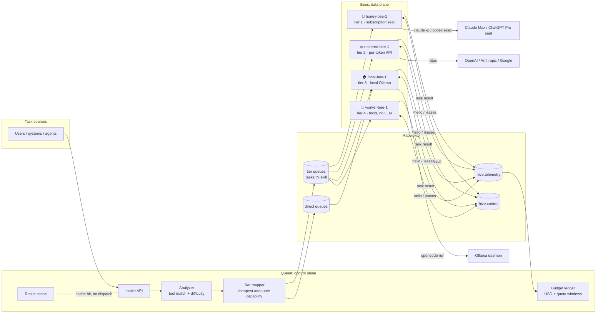
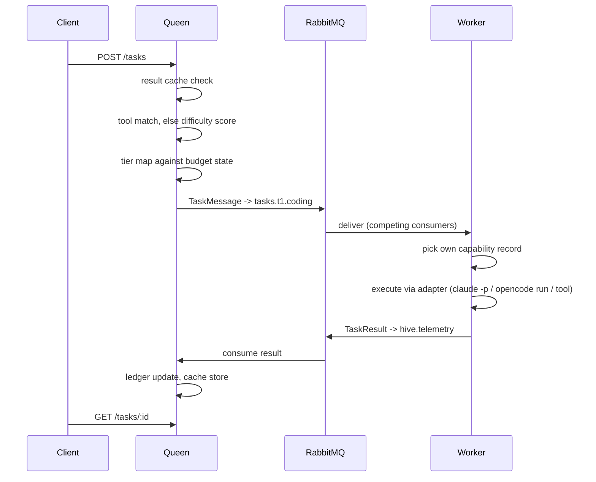
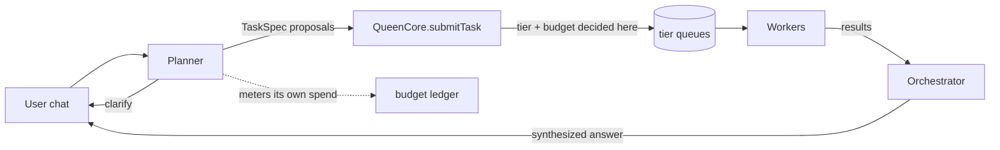
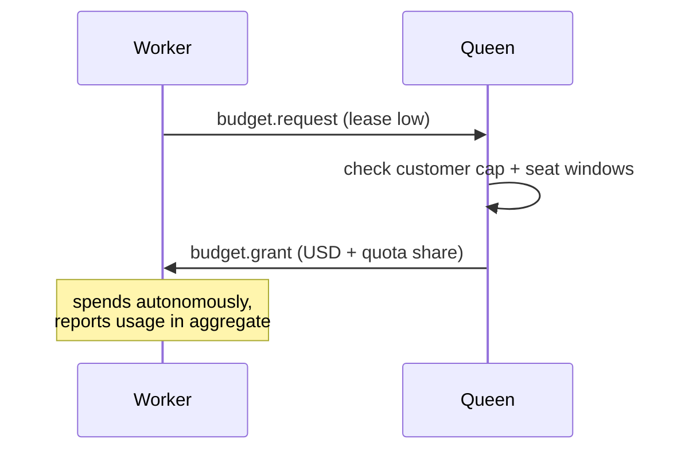

# Agent Hive

An AIoT agent management system whose single north-star metric is **token optimization**: the lowest possible cost per completed task. Worker bees do the work. The Queen keeps them coordinated, solvent, and cheap. Users talk to the Queen in plain language; she turns the conversation into tasks and routes each one to the cheapest capability that can complete it.

Every mechanism in this document — the capability ladder, tool-match-first dispatch, the dual-currency budget, leases, the result cache, even the planner's own cost ladder — is in service of that one metric. Cost is not an afterthought bolted onto a router; it *is* the router. The cheapest token is the one never spent.

AIoT Lab is the first customer. The core is customer-agnostic: everything AIoT-Lab-specific lives in `customers/aiotlab.yaml`.

## 1. Goals and non-goals

Goals:

- **Token optimization is the primary goal.** Minimize cost per completed task, per customer; every other goal is subordinate to it.
- Route every task to the most cost-effective execution capability, local or cloud.
- Keep the request path decentralized. The Queen works at task granularity. No central server sees every LLM call.
- Central budget control without central execution: the Queen sets budgets, workers spend autonomously.
- Support many customers from one core, with per-customer budgets, tools, and policies.

Non-goals (for the PoC):

- High availability, auth, multi-site federation. See the roadmap in section 9.
- Fine-grained per-message accounting. Telemetry is aggregated by design.

Why not a centralized router? A single proxy in front of every model call becomes a bottleneck, a single point of failure, and a privacy chokepoint. In Agent Hive the broker carries only small control and task messages. Model calls happen at the edge, inside each worker.

## 2. The capability model

An agent's ability is the pair **agent type x LLM model**, plus skill tags. Not the agent type alone. OpenCode on qwen3:8b and OpenCode on a cloud frontier model are different capabilities with different costs.

Capabilities are organized in a 4-tier ladder:

| Tier | Bee | Composition | Examples | Billing |
|---|---|---|---|---|
| 1 | 🍯 honey bee | Official agent + paid frontier model | Claude Code on a Claude Max seat, OpenAI Codex on ChatGPT Pro | subscription |
| 2 | 💵 metered bee | Paid model, per call | OpenAI / Anthropic / Google APIs, OpenCode/OpenClaw/Hermes on Ollama cloud | per-token or subscription |
| 3 | 🏠 local bee | Open-source agent + local model | OpenCode/OpenClaw/Hermes + local Ollama | local (~0) |
| 4 | 🐝 worker bee | Hardcoded tool, no LLM | parsers, report generators, converters | free |

The bee names are the tier ladder, not a second taxonomy on top of it: a bee *is* a worker process that owns one tier. That correspondence is what lets the solo launcher run all four on the embedded broker at once (§3, transport backends).

**Cost and capability are separate axes.** The key commercial insight: subscription seats are prepaid. Their marginal token cost is ~0 inside the quota window. That makes tier 1 cheaper per task than tier-2 per-token API, despite being more capable. Per-token API is the true last resort.

Cost ranking (cheapest first): free tools, local models, Ollama cloud seat, frontier seat, per-token API. For complex tasks the frontier seat outranks the mid seat: both are prepaid, so capability wins at equal cost class.

## 3. Components

Each bee owns one tier, so their queue bindings are disjoint — that is what lets all four share the embedded MQTT broker on a single machine (§3, transport backends). Under RabbitMQ you can additionally run several bees on the *same* tier as competing consumers.

The Queen never touches a model for execution. Workers never talk to each other directly; everything flows through named exchanges.

## 4. Message protocol

All payloads are JSON, validated with Zod schemas from `packages/shared/src/messages.ts`. Three topic exchanges:

| Exchange | Routing keys | Messages |
|---|---|---|
| `hive.tasks` | `tasks.t<tier>.<skill>`, `tasks.t4.<toolId>`, `tasks.direct.<agentId>` | `TaskMessage` |
| `hive.control` | `agent.hello`, `agent.heartbeat`, `budget.request.*`, `budget.grant.*` | `AgentHello`, `AgentHeartbeat`, `BudgetRequest`, `BudgetGrant` |
| `hive.telemetry` | `task.result.*`, `telemetry.usage.*` | `TaskResult`, `UsageReport` |

Tier queues are shared work queues (competing consumers, prefetch 1, manual ack, dead-letter on failure). Any worker with a matching capability record pulls from them. Direct queues implement pinned dispatch for site-bound tasks.

**Transport backends.** The queen and workers are written against one `Bus` interface (`packages/shared/src/bus`), with two implementations selected by `HIVE_BROKER`. `amqp` (default) is RabbitMQ — the large-scale, multi-node path. `mqtt` is an embedded [Aedes](https://github.com/moscajs/aedes) broker: a pure-JS broker that installs from npm and runs in-process, so `npm run solo` brings up broker + Queen + worker + console on one machine with no Docker. The exchanges map to MQTT topics with QoS-1 delivery and dead-letter-on-failure; the one RabbitMQ feature the MQTT backend lacks is competing-consumer load-balancing across *overlapping* workers (Aedes has no shared subscriptions).

That is a constraint on overlap, not on worker count. Two workers bound to the same tier+skill would each receive every such task and both would execute it — but workers with *disjoint* bindings never contend. So solo mode runs one bee per tier (honey 1, metered 2, local 3, worker 4) and every task still has exactly one taker. The Queen warns per overlapping tier+skill key if that invariant is broken. Use the amqp backend when you want several workers sharing the same tier.

`TaskMessage` carries a `capabilityHint`: the record the Queen priced the dispatch against. It is a hint, not a command. The consuming worker honors the tier and billing class but picks its own matching record. This keeps workers autonomous at the per-call level.

Key `TaskSpec` fields: `customerId`, `title`, `input`, `artifacts` (references, never content), `skills`, `sensitivity`, `urgency`, `pinnedAgentId`, `toolInput`.

## 5. Task lifecycle

Dispatch decision, in order:

1. **Tool match first.** A registered tier-4 tool whose required input keys and skills match executes deterministically. Zero tokens beat any LLM.
2. **Difficulty scoring.** Heuristics (length, code presence, multi-step verbs) map to `simple | standard | complex`. Zero tokens; a small local model can be layered on for ambiguous cases.
3. **Cheapest adequate capability.** Candidates from live worker registrations, filtered by tier adequacy, skill, and confidentiality, sorted by cost rank.
4. **Quota before dollars.** Subscription seats dispatch while their window has tokens. Per-token API dispatches only when the task is urgent, quota is gone, and the customer's USD cap allows.
5. **Defer or degrade.** Non-urgent work with empty seats waits for the window reset. If nothing adequate is affordable, the task degrades to the best local capability and the result is marked `degraded`.

Escalation on failure moves up in capability (tier 3 to tier 1 seat, not to per-token). The retry carries a short failure summary, never the lower-tier transcript. After `MAX_ATTEMPTS` the task fails permanently.

## 5b. The conversational Queen (planner)

Users chat with the Queen instead of posting structured tasks. A **planner** sits in front of the deterministic core and turns conversation into task specs. The rule that keeps the system honest: **the planner proposes, the core disposes.** The planner emits `TaskSpec` objects, which carry no tier or budget fields. The tested tier mapper and budget ledger still decide every cost question. A planner cannot route a task to an expensive tier even if the model tries.

Each turn:

1. A cheap heuristic scores the message. Simple messages use a small local model; only complex ones escalate to a configured stronger `plannerModel`. The Queen's own reasoning follows the same cost ladder as the workers, so the brain does not become a hidden cost center.
2. The planner model returns one structured decision, validated with Zod: `clarify` (ask a follow-up), `plan` (one or more tasks with `dependsOn` edges), or `answer` (reply directly, no work). Out-of-vocabulary enum values from a small model fall back to safe defaults rather than discarding the whole plan; `confidential` only ever comes from the exact word, so the safety gate never loosens by accident.
3. The orchestrator runs the plan as a DAG. Ready tasks run in parallel waves through `QueenCore.submitTask`. A parent's result is written to the artifact store and passed to its children by reference, never inlined, keeping decomposition cheap in tokens.
4. Results are synthesized into one answer. A single task returns its output directly; multiple tasks get one summarizing call.

Planner spend is metered through the same cost estimator with a reserved `planner` identity and surfaced separately in `/status`, so its cost is always visible next to worker cost.

Chat is served over SSE (`POST /chat`). The stream carries the planner decision, any clarifying question, a live task card per step (tier, runtime, model, cost, `degraded`), and the final answer. The web console renders these; the routing of every step is visible, which answers "why did this cost what it cost" directly in the UI.

## 6. Budget model: dual currency

Subscription seats and API dollars behave differently, so the ledger tracks both:

- **USD**: per-token spend, priced from `llm_model_api_catalog.yaml`, capped per customer.
- **Quota**: each seat (Claude Max, ChatGPT Pro, Ollama cloud plan) has a rolling token window (e.g. 5-hour). The Queen meters usage from worker reports and stops dispatching to a near-empty seat. Windows refill on their own; deferred work resumes automatically.

Leases delegate spending. A worker requests a lease over the broker, receives a USD allowance plus a quota share, spends autonomously, and asks again when low. The Queen never approves individual calls.

Zero-budget behavior: tiers 3 and 4 cost nothing marginal, so the hive keeps producing when USD is spent and every seat is empty, just at lower capability.

## 7. Token minimization

Four levels, in order of impact:

1. **Never spend the token.** Tool-match-first, local-first, and the Queen's result cache (normalized input hash) that answers repeated tasks with zero dispatch.
2. **Quota before dollars.** Prepaid seats absorb heavy agentic work. Non-urgent overflow waits for the window reset instead of paying retail.
3. **Send less per call.** Artifacts travel as references; workers inline only a capped slice. Escalations carry failure summaries, not transcripts. Adapters enforce context budgets.
4. **Pay less per token.** Stable prompt prefixes for cache hits (cached input is ~10x cheaper), smallest adequate model, batch API for non-urgent per-token work.

The metric: cost per completed task, per customer, from telemetry. It should fall as tool and local coverage grows.

## 8. Runtimes

Ollama is the managed local runtime layer. `ollama launch opencode` and `ollama launch openclaw` provision those agents natively (install, provider config, model selection). Hermes connects to Ollama's OpenAI-compatible endpoint. The worker's discovery loop asks the Ollama daemon for installed models and rebuilds capability records automatically: local tags become tier 3, cloud tags become tier 2 on the Ollama plan seat. Pull a model and the worker re-registers within 30 seconds.

Adapter families in `packages/adapters`:

- **official-agent** (tier 1, 🍯): Claude Code headless (`claude -p --output-format json`) with real token/cost reporting, and Codex headless (`codex exec --json`), parsing the final agent message and the `turn.completed` token usage. On a subscription seat both report zero marginal USD; the seat's quota window absorbs the tokens. Auth comes from each CLI's own logged-in session — the hive never sees a credential.
- **api-model** (tier 2, 💵): paid models called directly over their provider HTTP APIs — OpenAI chat completions, Anthropic messages, Google generateContent — with the provider resolved from the model id. The only runtime that spends real money per call, which is why the Queen ranks it last and dispatches it only for urgent overflow. It deliberately does **not** report its own USD: the providers return real token counts, and the worker prices those through `CostEstimator` against `llm_model_api_catalog.yaml`, so estimates and actuals share one pricing path. `HIVE_API_DRYRUN=1` skips the network while still reporting realistic token counts, so the ledger, budget guard and cap behave exactly as live.
- **ollama-agent** (tiers 2/3, 🏠): executes via `opencode run`, the OpenClaw gateway, or the Hermes CLI. If the runtime binary is missing it falls back to a direct Ollama chat call, marked `ollama-direct`, so a bare Ollama host still serves tier 3.
- **tool** (tier 4, 🐝): registry of `{toolId, inputSchema, run}` programs. Adding a tool is one entry plus one line in the customer profile.

Adding a runtime for a new customer is one adapter entry. The core never changes.

**Capability preflight.** A worker advertises only what it can actually execute. Discovery already returns nothing when Ollama is absent; the same rule now covers statically-configured records — a `claude-code` capability is dropped when `claude` isn't on PATH, an `api` capability when its provider key is unset. Advertising less is the honest failure mode: the Queen routes to the next-cheapest bee instead of dispatching into a runtime that would fail and burn escalation attempts. It also means one set of configs works unchanged on a fully-equipped laptop and a bare one.

## 9. Production roadmap

- RabbitMQ quorum queues and clustering; mTLS on broker connections.
- Broker-side shared-subscription emulation for the embedded MQTT backend, so overlapping workers can be load-balanced on one machine without RabbitMQ.
- Per-site sub-queens: a site queen owns local dispatch, the top queen owns budgets, forming a hierarchy for multi-fab customers.
- Real seat quota tracking fed from provider usage APIs instead of estimates.
- Durable task store and audit trail (Postgres), Prometheus metrics per worker, web dashboard replacing the console status view.
- vLLM as a second local serving backend beside Ollama.
- Batch API integration for non-urgent per-token overflow.
- Semantic result cache (embedding similarity) on top of the exact-hash cache.
