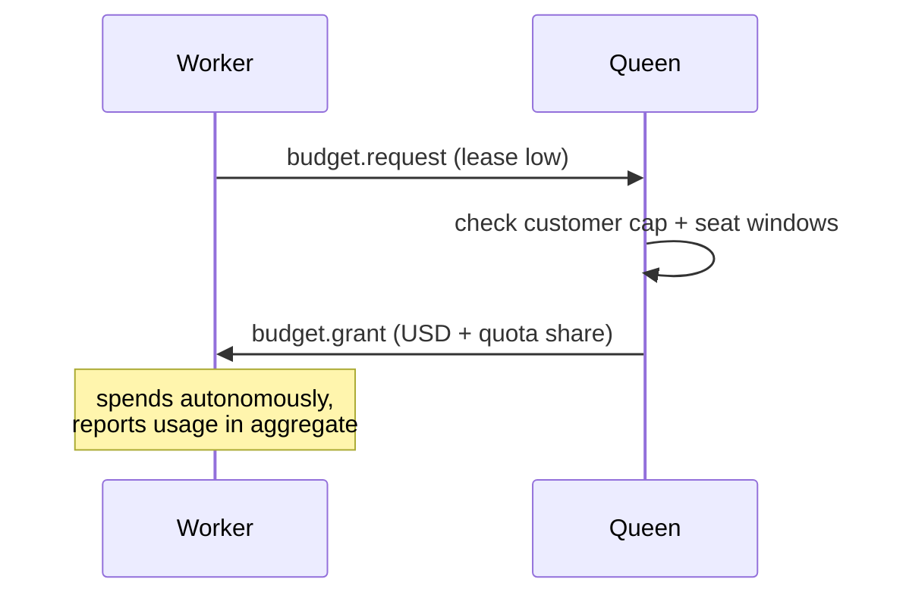

# Budgets and dual currency

Subscription seats and API dollars behave differently, so the ledger tracks both.
They do not convert into each other, and optimizing means spending the second
before ever touching the first.

## The two currencies

**USD** — per-token spend, priced from `llm_model_api_catalog.yaml`, capped per
customer by `budget.capUsd`. Real money, spent only for urgent work when nothing
prepaid is available.

**Quota** — each [seat](/reference/glossary#seat) (Claude Max, ChatGPT Pro, an
Ollama cloud plan) has a rolling token window, e.g. five hours. The Queen meters
usage from worker reports and stops dispatching to a near-empty seat. Windows
refill on their own, and deferred work resumes automatically.

## Leases delegate spending

The Queen never approves individual calls. That would put it in the path of every
model invocation, which is exactly the centralization the architecture avoids.



A worker requests a lease over the broker, receives a USD allowance plus a quota
share, spends autonomously against its local [wallet](/reference/glossary#wallet),
and asks again when low.

## The worker-side budget guard

Before making a call, a bee checks what it would cost against what the task's
envelope allows. A call that would cost more is **refused**.

That refusal costs nothing, because the call never happens — which is the whole
point. `demo/walkthrough.sh --frontier` demonstrates it live, showing the guard
turning down a call priced at 11.8× the task's cap.

## Zero-budget behavior

Tiers 3 and 4 cost nothing marginal, so **the hive keeps producing when USD is
spent and every seat is empty** — just at lower capability.

There is no state in which the hive stops answering for lack of money. There is
only a state in which it answers less well, and says so with the `degraded`
marker.

## Blocked: wait or degrade

When every adequate capability is blocked on budget, `policy.onBudgetBlock`
decides:

- **`wait`** — hold for the seat window to reset. Full quality, higher latency.
  The task shows `deferred`.
- **`degrade`** — run now on a local model, marked `degraded`.

`customers/aiotlab.yaml` uses `wait`, `customers/demo-lab.yaml` uses `degrade`.
Submitting the same task to both is the cleanest way to watch the policy actually
choose.

## Seats are global, and declaration is first-write-wins

Worth repeating here because it surprises people: seats are global
infrastructure keyed by `seatId` across the whole ledger. A customer profile
*declares* a seat; it does not scope it, and `addSeat` is first-write-wins.

Redeclaring the same `seatId` in a second profile with a different window is
silently ignored. See
[Customer profiles](/reference/customer-policy#seats-are-global-and-first-write-wins).

## Two measurement traps that were real bugs

**`usage.input_tokens` is the uncached remainder, not the prompt size.** A resumed
`claude -p` turn was measured reporting `input_tokens: 2` against
`cache_read_input_tokens: 35202`. Adapters therefore report
`input + cache_creation + cache_read` and carry the two cache counts separately.

This is not pedantry: on a subscription seat the Queen meters the quota window on
`inputTokens + outputTokens`, so reporting the remainder made a seat that had
just burned 35,000 tokens look untouched.

**The result cache key omitted `sensitivity`.** A confidential submission worded
identically to an earlier normal one was answered out of a cache filled by a task
that had made no confidentiality promise. The key now includes `sensitivity` and
`continues`, and the cache is bounded by age and count like every other memo in
the hive.

## Persistence and reset

The ledger — spend plus seat-window state — persists to `data/ledger.json` and
reloads on startup, so budget state survives a Queen restart.

```bash
npm run reset    # clear it; it rebuilds from customers/*.yaml on next start
```

## Watching it

```bash
curl -s localhost:4100/status | jq .budget
npm run watch        # live seat quota and budget in the terminal
npm run scoreboard   # what it cost, vs. what all-frontier would have cost
```

## Full detail

[§6 Budget model: dual currency](/DESIGN#_6-budget-model-dual-currency).
