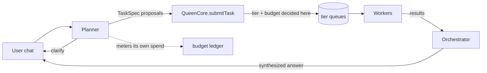

# The conversational Queen

Users chat with the Queen instead of posting structured tasks. A **planner** sits
in front of the deterministic core and turns conversation into task specs.

## The planner proposes, the core disposes

The rule that keeps the system honest.

The planner emits `TaskSpec` objects, and `TaskSpec` **carries no tier field and
no budget field**. The tested tier mapper and budget ledger still decide every
cost question. A planner cannot route a task to an expensive tier even if the
model tries.

## A turn, step by step

1. **A cheap heuristic scores the message.** Simple messages use a small local
   model; only complex ones escalate to a configured stronger `plannerModel`. The
   Queen's own reasoning follows the same cost ladder as the workers, so the
   brain does not become a hidden cost center.

2. **The planner model returns one structured decision**, validated with zod:
   - `clarify` — ask a follow-up
   - `plan` — one or more tasks with `dependsOn` edges
   - `answer` — reply directly, no work at all

   Out-of-vocabulary enum values from a small model fall back to safe defaults
   rather than discarding the whole plan. And `confidential` only ever comes from
   the exact word, so the safety gate never loosens by accident.

3. **The orchestrator runs the plan as a DAG.** Ready tasks run in parallel waves
   through `QueenCore.submitTask`. A parent's result is written to the artifact
   store and passed to its children **by reference, never inlined** — which is
   what keeps decomposition cheap in tokens.

4. **Results are synthesized into one answer.** A single task returns its output
   directly; multiple tasks get one summarizing call.

## The two fields that do carry routing meaning

`TaskSpec` has no tier or budget — but two planner-settable fields *do* affect
routing:

- **`urgency`**, which unlocks per-token spend.
- **`sensitivity`**, which decides whether work may leave the machine.

Both are **grounded in the user's own words** rather than taken at face value
from the plan. A memory or a guide telling the planner to mark everything urgent,
or everything routine, gets overruled.

## Planner spend is visible

Metered through the same cost estimator, under a reserved `planner` identity, and
surfaced separately in `/status` as `plannerCostUsd`. Its cost is always readable
next to worker cost — that is the point of putting it there.

## Phases, not streamed tokens

The turn narrates itself as `phase` events with elapsed time:

> `recalling → planning → decided → dispatching → waiting → synthesizing → learning → complete`

The console renders them as one line that changes in place, so a turn in progress
says *which part* is taking the time rather than only that something is.

This is deliberate, and the reasoning is worth knowing. The planner call runs
with Ollama's `format: "json"`, so streaming it would type out JSON syntax — the
appearance of thinking without the substance. Real reasoning text would need a
thinking-capable model and Ollama's `think` flag, which would quietly narrow
which models are allowed to be the Queen's brain. Phases cost nothing, work on
every model, and carry the fact actually worth showing while you wait: which
model is running, and for how long.

## Planning is overhead

The Queen's own reasoning sits on the user's latency path, and one Queen will
eventually front thousands of users — so a planner call must earn its place by
changing the outcome.

Two consequences already implemented: **reflection runs off the turn** rather
than merely after it, so the answer no longer waits on learning; and every phase
is timed into the episode record, so "the Queen over-plans" is a measurement
rather than an impression.

## Session affinity: a follow-up is not a cold start

`TaskSpec.continues` asks that a follow-up resume the same runtime session on the
same bee. It is a **request, not an instruction**: the Queen honors it only if
the predecessor's bee is still live, still holds the session, and is allowed to
run work at this sensitivity. Nothing fails when it is refused — the task just
runs cold.

That last condition is a real gate rather than a formality. A pin becomes a
direct queue key, which bypasses the tier queues — and the tier queues are where
the confidentiality check lives. So a confidential task pinned to a
subscription-billed bee would have run on a cloud seat with the routing decision
that forbade it sitting correctly in the log. The affinity path now asks the same
question about the one worker it is about to name. See
[§5d](/DESIGN#_5d-session-affinity-a-follow-up-is-not-a-cold-start).

## Full detail

[§5b The conversational Queen](/DESIGN#_5b-the-conversational-queen-planner) in
the design document.
